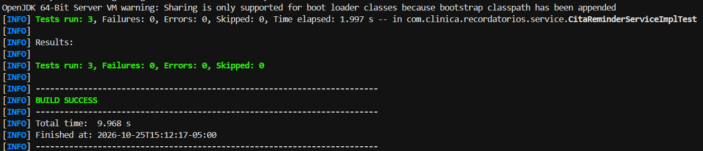
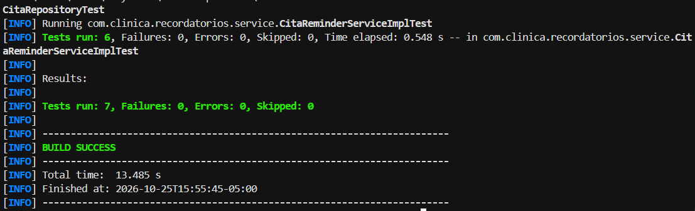
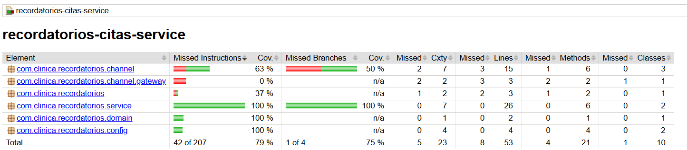
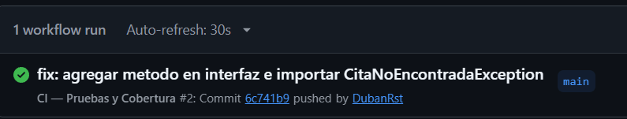

# Recordatorios Citas Service


## Descripción

Repositorio del post-contenido de la Unidad 9 de Patrones de Diseño de Software. Un único proyecto Spring Boot que envía recordatorios de citas por el canal preferido del paciente (correo o SMS), construido desde el inicio con Strategy (ReminderChannel) y Factory Method (ReminderChannelFactory) inyectados por constructor.

## Parte 1: Pruebas unitarias con JUnit 5 y Mockito

CitaReminderServiceImplTest aísla CitaReminderServiceImpl de sus colaboradores (CitaRepository, ReminderChannelFactory, ReminderChannel y Clock). Ver "Decisiones de diseño" para la justificación de por qué cada uno se mockeó o se resolvió con un fake.

## Parte 2: Refactor DIP, integración y CI/CD

enviarRecordatorioUrgente nació con un `new` hardcodeado que lo hacía imposible de testear; el refactor movió la construcción a `config/CanalUrgenteConfig.java` e inyectó la abstracción por constructor. CitaRepositoryTest (@DataJpaTest) y CitaReminderServiceIntegrationTest (@SpringBootTest) prueban la persistencia y el flujo completo con H2 y un Clock fijo. El pipeline `.github/workflows/ci.yml` ejecuta `mvn verify` en cada push.

## Decisiones de diseño

### Mapeo patrón → prueba

| Prueba | Qué la facilita | Sin ese patrón sería más difícil porque |
|---|---|---|
| `citaEnVentana_usaElCanalPreferido` | Factory Method + Strategy | La selección de canal estaría en un if/else dentro del servicio y solo sería observable por sus efectos (lo impreso o lo enviado realmente). |
| `sinCitasPendientes_noConsultaLaFactory` | Factory inyectada | `verifyNoInteractions` solo es posible si la factory es un colaborador separado y sustituible. |
| `ventanaDeterministaSegunClockFijo` | Clock inyectado (DIP) | Con `LocalDateTime.now()` directo, la ventana cambiaría en cada ejecución y no se podrían afirmar los límites exactos. |
| `enviarRecordatorioUrgente_*` | DIP aplicado en el refactor + Strategy | Con el `new` dentro del método no había dónde insertar un test double. |
| `CitaReminderServiceIntegrationTest` | Interfaz NotificadorSmsGateway | Sin la interfaz, el contexto completo dependería de un proveedor de SMS real. |

### Por qué Strategy facilitó las pruebas

Sin ReminderChannel como interfaz, la lógica de envío (SMTP o SMS) estaría escrita en línea dentro del servicio, y probar la selección de canal exigiría mockear librerías de bajo nivel en vez de una sola interfaz propia con un método `enviar()`. Con Strategy, un único `@Mock ReminderChannel` basta para verificar cualquier canal.

### Por qué Factory Method facilitó las pruebas

Sin ReminderChannelFactory, el servicio tendría un if/else o un switch embebido decidiendo el canal, y esa decisión solo sería observable indirectamente. Con la factory inyectada, la selección de canal se verifica como una interacción explícita: `obtenerCanal(EMAIL)`.

### Mock, stub o fake (Parte 1)

CitaRepository y ReminderChannelFactory/ReminderChannel se mockearon porque las pruebas verifican interacciones (`save()`, `obtenerCanal()`, `enviar()`), no solo valores de retorno. Clock se resolvió con `Clock.fixed(...)`, un fake real del JDK, porque mockearlo habría sido más complejo y menos fiel al comportamiento real.

### El refactor DIP (Parte 2)

**Diagnóstico.** La línea responsable era `new SmsReminderChannel(new TwilioNotificadorSmsGateway())` dentro del cuerpo de `enviarRecordatorioUrgente`. Mockito necesita un punto por donde entrar para sustituir un colaborador, y con la construcción dentro del método no existía ninguno. En cambio, `enviarRecordatoriosPendientes()` ya era testeable desde la Parte 1 porque sus colaboradores llegan por constructor.

**Antes:**

```java
ReminderChannel canalUrgente = new SmsReminderChannel(new TwilioNotificadorSmsGateway());
canalUrgente.enviar(cita, "URGENTE: ...");
```

**Después:**

```java
// CanalUrgenteConfig (composition root)
@Bean
public ReminderChannel canalUrgente(NotificadorSmsGateway gateway) {
    return new SmsReminderChannel(gateway);
}

// CitaReminderServiceImpl: recibe la abstracción por constructor
canalUrgente.enviar(cita, "URGENTE: ...");
```

Mover el `new` a la configuración de Spring lo hizo testeable sin cambiar su comportamiento externo. La prueba `enviarRecordatorioUrgente_gatewayFalla_noMarcaComoEnviado` es la evidencia de que la testabilidad es consecuencia directa de aplicar DIP.

### H2 real con gateway mockeado

En la misma prueba de integración conviven una base de datos real (H2 en memoria) y un `@MockBean` sobre NotificadorSmsGateway. H2 es un fake aceptable porque su contrato SQL/JPA es equivalente al de la base real y no requiere infraestructura. Un proveedor de SMS de terceros no tiene un equivalente gratuito y determinista; mockearlo evita depender de credenciales, de red y de la disponibilidad del proveedor en cada ejecución del pipeline.

### CI sin contenedor de base de datos

El workflow no declara servicios de base de datos porque las pruebas de integración usan H2 en memoria. Probar contra PostgreSQL con Testcontainers habría requerido un runner con Docker y tiempos de arranque mayores.

## Ejecutar las pruebas

```powershell
mvn test      # todas las pruebas (unitarias e integración)
mvn verify    # igual que test, más el reporte de cobertura JaCoCo
```

El reporte queda en `target/site/jacoco/index.html`.

## Evidencias

| Evidencia | Captura |
|---|---|
| Pruebas de la Parte 1 en verde |  |
| Pruebas finales en verde (8) |  |
| Reporte de cobertura JaCoCo |  |
| Workflow de GitHub Actions en éxito |  |

## Herramientas utilizadas

- Java 21, Spring Boot 3.3, Spring Data JPA, H2, JUnit 5, Mockito, JaCoCo
- Apache Maven, GitHub Actions, Git, GitHub, VS Code

## Conclusiones

Este post-contenido mostró que la testabilidad no se agrega al final con herramientas más potentes, sino que es consecuencia del diseño: Strategy, Factory Method e inyección por constructor dejaron puntos de sustitución claros para cada prueba. El caso de enviarRecordatorioUrgente lo confirmó, porque un solo `new` dentro de un método bastó para volver imposible una prueba, y moverlo a la configuración la habilitó sin cambiar el comportamiento. También quedó claro que elegir entre mock, stub y fake depende de lo que se quiera verificar: interacciones, valores de retorno o una implementación real y determinista como `Clock.fixed`. Por último, usar H2 en lugar de una base externa simplificó tanto las pruebas de integración como el pipeline de CI.